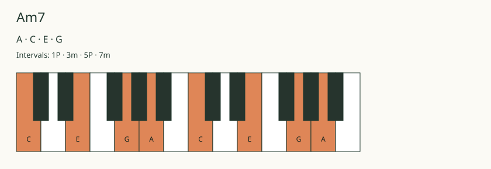

# Chord Chart Generator MCP

Chord Chart Generator MCP turns musical requests into diagrams an assistant can return in a conversation. A request for Am7, for example, can produce its notes—A, C, E and G—a highlighted piano keyboard, and guitar or ukulele fingerings.

**MCP** stands for Model Context Protocol: the interface through which an assistant discovers tools and sends them structured requests. The TypeScript server resolves the musical data and draws the result. It also accepts ABC, a text format for musical notation, and turns it into a staff score.

*Example output from the renderer, rather than a screenshot of an assistant conversation. The highlighted keys identify the notes in Am7.*

## What it produces

| Request | Tool | Result |
| --- | --- | --- |
| Show a chord | `render_chord` | Notes, their musical intervals, a keyboard diagram and stored fretted-instrument shapes |
| Show a chord sequence | `render_chord_progression` | Diagrams in playing order; optional Roman-numeral labels describe each chord's relationship to a supplied key |
| Show a scale | `render_scale` | A keyboard or fretboard map, plus the three-note chords (triads) formed from a seven-note scale |
| Show written music | `render_notation` | A staff score from ABC, with optional guitar tablature showing strings and fret numbers |

## Engineering challenges and solutions

### Resolving the music before drawing it

A chord symbol is compact, but its diagram needs explicit pitches and positions. The theory layer resolves note spelling and intervals—the musical distances between notes. A stored fingering database supplies concrete frets, fingers and barres for guitar and ukulele; a barre means one finger holds several strings at the same fret.

The renderer receives that resolved data instead of asking a language model to invent drawing geometry or fingerings. Some valid chords have no stored shape. In that case, the result says so and still provides pitch information. Tests check that stored shapes produce pitches belonging to their chord.

### Using the same drawing logic for images and embedded displays

Some clients display an image; others support a widget inside the conversation. Two independent renderers would be easy to change inconsistently.

The shared renderer produces **SVG**, a vector drawing. The server converts that drawing to a **PNG** image, while the browser widget uses the same drawing code with the resolved musical data. This also lets the widget redraw diagrams for light or dark themes. The large fingering database stays on the server rather than being bundled into the display.

### Providing an image even when a widget is unavailable

Each tool returns a text summary, PNG content and structured data. A registered HTML resource provides an additional display path for clients supporting MCP Apps, the extension for embedded interfaces.

The image path can be tested independently of that interface. The local smoke test starts the real server, discovers the tools, calls each one and checks its response. It also fetches the widget resource. A successful protocol test does not establish how every assistant host will display it; ChatGPT and Claude demonstrations are still pending.

### Validating requests before generating output

The server checks instrument choices, musical input, chord-count limits and notation length before rendering. It escapes label text in SVG, so text such as angle brackets remains text. The browser widget also accepts only a restricted set of drawing elements and attributes instead of inserting arbitrary HTML.

Unrecognized chords return an error rather than silently becoming a different chord. Missing stored fingerings are handled as missing data rather than a fabricated result.

### Giving staff notation its own layout engine

Drawing a keyboard is different from positioning notes, clefs, bars and tablature. The server uses an ABC engraving library for that job, then passes its generated SVG through the image output path.

The headless layout uses approximate text measurement, so complex scores still need visual checks. The score is for reading; playback and interactive notation editing are not implemented.

## Testing and current status

The current implementation passes TypeScript checking and fourteen tests covering musical spelling, fingering pitches, request limits, SVG output, PNG headers, themes, notation/tab and local HTTP behavior. A separate stdio smoke test checks all four tools, their responses, the widget resource and invalid input.

**Stdio** connects a local client to a server process through standard input and output. The alternative **Streamable HTTP** entry point uses local web requests. Both are implemented and tested locally. The widget builds successfully, but live assistant-host behavior and a public HTTPS service have not been verified.

The application source remains private.
