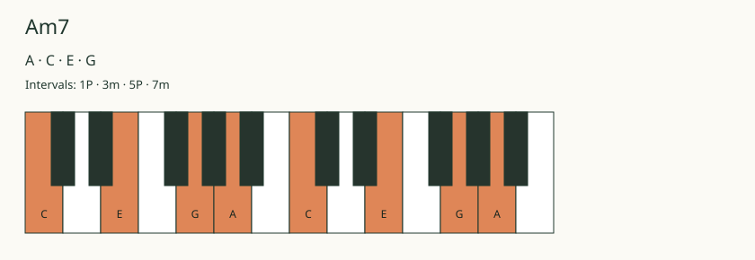

# Implementation reference

Chord Chart Generator MCP generates musical diagrams and notation for assistant conversations. A request for Am7 can return its notes, A, C, E and G, with a piano diagram and available guitar or ukulele fingerings.

The server is written in TypeScript and uses Model Context Protocol (MCP) to expose its tools to an assistant. It also accepts ABC, a text format for written music, and renders it as staff notation.

*An Am7 keyboard diagram generated by the renderer.*

## Tools

| Tool | Output |
| --- | --- |
| `render_chord` | Chord notes, intervals, a keyboard diagram and available fretted-instrument shapes |
| `render_chord_progression` | Chord diagrams in order, with optional Roman-numeral labels relative to a supplied key |
| `render_scale` | Keyboard or fretboard maps, plus triads for seven-note scales |
| `render_notation` | Staff notation from ABC, with optional guitar tablature |

## How it works

### Musical data

The assistant sends a structured request. The server validates the instrument, musical input and size limits, then resolves note spellings and intervals. Guitar and ukulele diagrams use stored fingerings with fret, finger and barre positions. If no fingering is stored for a valid chord, the response includes its pitches and reports that the shape is unavailable.

The drawing code receives this resolved data. Musical interpretation and diagram layout stay separate, so the renderer does not have to infer notes or fingerings from a chord name.

### Diagrams and widgets

A shared renderer produces SVG, a vector image format. The server converts the SVG to PNG for image responses. An embedded browser widget uses the same drawing code and musical data, including light and dark themes. The fingering database stays on the server to keep it out of the widget bundle.

Tool responses include a text summary, a PNG and structured data. Clients supporting MCP Apps can also load the registered HTML widget. The image response provides a display option independent of widget support.

Labels are escaped before being included in SVG. The widget accepts a restricted set of drawing elements and attributes. Unrecognized chords return errors, and missing fingerings remain missing data.

### Staff notation

An ABC engraving library lays out notes, clefs, bars and tablature. Its SVG output follows the same image conversion path as the diagrams. The headless renderer uses approximate text measurement for score layout.

## Tests and connections

Local checks pass TypeScript checking and fourteen tests covering music data, stored fingerings, request limits, image output, themes, notation and HTTP behavior. A stdio smoke test starts the server, discovers and calls the tools, and checks the widget resource and invalid input.

The server supports stdio for a local process connection and Streamable HTTP for web requests. Both have been tested locally, and the widget builds successfully.

The application source remains private.
